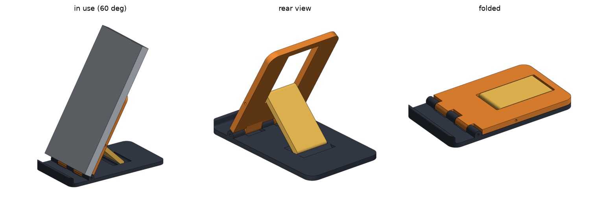

# 折叠手机支架

可折叠、三档角度的手机支架。折叠后是一块 122 × 70 × 10 mm 的圆角薄板，可以放进口袋或包里。



## 规格

| 项目 | 数值 |
| --- | --- |
| 折叠尺寸 | 122 × 70 × 10 mm |
| 角度 | 50° / 60° / 70°（靠背与桌面夹角） |
| 可放手机厚度 | 约 12 mm 以内（含壳） |
| 零件 | 底板、靠背、撑杆，共 3 件 |
| 另需 | 1.75 mm 打印耗材两段，各 70 mm，当铰链销 |

## 打印

三个零件都平放打印，不需要支撑。可以分别导入 `base.stl`、`backrest.stl`、`strut.stl`，也可以直接用排好版的 `plate_all.stl`（占 165 × 148 mm）。

| 参数 | 建议 |
| --- | --- |
| 材料 | PLA 或 PETG |
| 层高 | 0.2 mm |
| 壁数 | 3 |
| 填充 | 20% |
| 支撑 | 不需要 |

文件里的姿态就是打印姿态：靠背是贴手机的一面朝下，这样正面最平整。三件用不同颜色打印效果更好。

三件实心体积合计约 67 cm³（PLA 约 83 g），实际用料以切片软件为准。

## 组装

1. 剪两段 70 mm 的 1.75 mm 耗材，用手捋直。
2. 把撑杆放进靠背中间的窗口，从靠背侧面的小孔穿入一段耗材。
3. 把靠背的两个铰链筒对准底板的三个铰链座，从侧面穿入另一段耗材。
4. 销子如果偏松会滑出，在两端点一滴胶水，或用烙铁把端头烫平。

孔径按 1.75 mm 耗材设计：固定一侧 2.1 mm，转动一侧 2.4 mm。如果你的打印机孔偏小、销子穿不进，用 2 mm 钻头通一下。

## 使用

抬起靠背，把撑杆向后翻下，撑脚卡进底板上的槽里。三道槽从前到后依次是 70°、60°、50°。收起时把撑杆翻回窗口，靠背放平即可。

手机底部直接放在底板上，所以竖放时没法从底部插线充电；横放可以正常充电。

## 修改尺寸

所有尺寸在 `generate.py` 顶部的参数区，改完重新生成：

```bash
pip install -r requirements.txt
python generate.py
```

常用参数：`W` 宽度、`L` 长度、`ANGLES` 三档角度、`HINGE_X` 铰链位置（手机厚就调大）、`PIN_GRIP` / `PIN_FREE` 销孔直径。

脚本会检查每个零件是封闭的单一实体，并检查折叠和各档展开姿态下零件互不穿插，然后输出 STL 和预览图。

## 说明

这个模型通过了几何检查，但还没有实物打印验证。铰链松紧和销孔配合与打印机精度有关，第一次打印后可能需要微调 `PIN_GRIP`、`PIN_FREE` 和 `GAP`。
