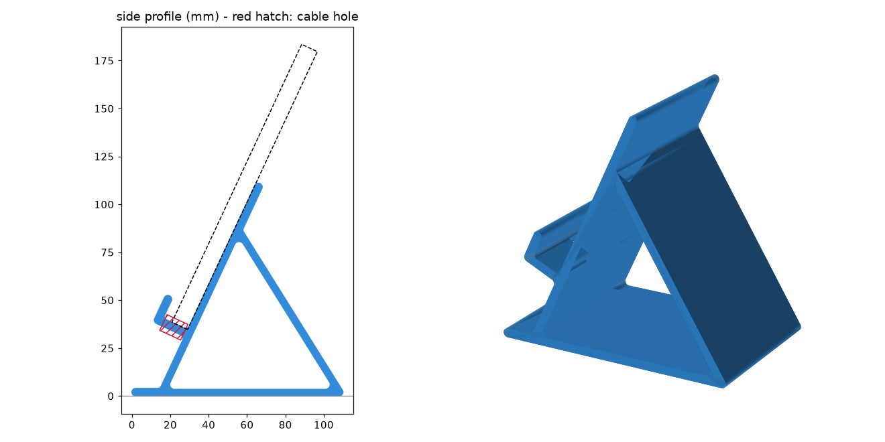

# 手机支架

桌面手机支架，竖放横放都可以。侧躺打印，不需要支撑。



## 规格

| 项目 | 数值 |
| --- | --- |
| 外形（使用姿态，长×宽×高） | 110 × 70 × 111 mm |
| 靠背角度 | 与桌面 65° |
| 卡槽净宽 | 14 mm（手机带壳厚度不超过 13 mm） |
| 壁厚 | 4 mm |
| 充电线孔 | 12 × 16 mm，位于托台正中 |
| 托台离桌面 | 约 30 mm，给充电插头留空间 |

## 打印

直接把 `phone_stand.stl` 导入切片软件即可，文件已经是打印姿态（侧躺，三角形轮廓贴在热床上）。

| 参数 | 建议 |
| --- | --- |
| 材料 | PLA 或 PETG |
| 层高 | 0.2 mm |
| 壁数 | 3 |
| 填充 | 15–20% |
| 支撑 | 不需要 |
| 热床占用 | 110 × 111 mm，高 70 mm |

充电线孔的顶部是一段 12 mm 的桥接，普通打印机开着冷却风扇就能打好。

实心体积 98 cm³（PLA 约 122 g）；按 3 层壁、15% 填充估算，实际用料大约 50–60 g，以切片软件的结果为准。

## 充电

把充电线从托台下方穿过线孔，插上手机后再把手机放进卡槽。

## 修改尺寸

所有尺寸都在 `generate.py` 顶部的参数区，改完重新生成：

```bash
pip install -r requirements.txt
python generate.py
```

常用参数：`WIDTH` 宽度、`ANGLE` 靠背角度、`SLOT` 卡槽净宽（手机厚就调大）、`CABLE_W` 线孔宽度（设为 0 不开孔）。

脚本会检查网格是封闭的单一实体，然后输出 `phone_stand.stl` 和 `preview.png`。
